  <picture>
    <source media="(prefers-color-scheme: dark)" srcset="docs/logo_full_dark.svg">
    
  </picture>

> [!NOTE]
> **Beta:** Datapages is ready for production use.
> APIs are close to stable but can still change.

Datapages is a web framework and toolchain for [Go](https://go.dev), [Templ](https://templ.guide) and [Datastar](https://data-star.dev). It supports collaborative web applications, [HTMX](https://htmx.org/)-style sites and installable desktop applications.

See [FAQ.md](FAQ.md) for frequently asked questions.

### Give coding agents project-specific guidance

`datapages init` writes instructions and skills for coding agents. `datapages lint` and `datapages gen` report invalid application declarations and template calls with file positions and suggested fixes.

### Focus on your business logic

Datapages parses and checks the application package, then generates the HTTP wiring. The generated code covers routes, sessions, SSE streams, per-tab state, CSRF protection, typed URL and action helpers, Prometheus metrics and offline service workers. Application code remains Go and Templ.

## Examples

- [`counter`](example/counter/): 2 real-time counters in 1 module. `app/simple` is the smallest example, and `app/fancy` adds a polished interface.
- [`todolist`](example/todolist/): Collaborative todo list with per-tab server-side state.
- [`calculator`](example/calculator/): Calculator that runs as a multi-client server or a single-client desktop app.
- [`classifieds`](example/classifieds/): Full-featured classifieds marketplace with sessions, auth, Prometheus metrics, Grafana dashboards and load testing.
- [`tailwindcss`](example/tailwindcss/): Minimal static page with Tailwind CSS.
- [`webcomponents`](example/webcomponents/): Landing page with vanilla and [Lit](https://lit.dev)-based Web Components bundled via esbuild through a custom watcher.
- [`sqlitesessions`](example/sqlitesessions/): Custom `sessions.Manager` backed by SQLite through [sqinn-go](https://github.com/cvilsmeier/sqinn-go), without cgo.
- [`fast-shim`](example/fast-shim/): A cached placeholder shown immediately and replaced with the live response.
- [`offline-cache`](example/offline-cache/): Service worker support with handler-cached pages, a `PageOffline` fallback, and tickets available without a connection.
- [`file-upload`](example/file-upload/): Chunked file uploads to disk that can be paused, resumed and continued after a reload or a server restart, with server-enforced transfer limits.
- [`docs`](example/docs/): Collaborative rich-text editor built on [Quill](https://quilljs.com), with operational transformation in Go.

## Getting Started

See the [documentation](guide/README.md). Start with the [installation](guide/installation.md) and the [tutorial](guide/tutorial/README.md).

## Specification

[SPECIFICATION.md](SPECIFICATION.md) defines handler signatures, parameters, return values, events, sessions and modules.

## Modules

Datapages includes modules with replaceable implementations:

- [`Manager[Data]`](modules/sessions/sessions.go)
  - [`natskv`](https://pkg.go.dev/github.com/romshark/datapages/modules/sessions/natskv) - NATS KV store with AES-128-GCM encrypted cookies
  - [`inmem`](https://pkg.go.dev/github.com/romshark/datapages/modules/sessions/inmem) - In-memory sessions (lost on restart; single-instance only)
- [`Broker`](modules/messaging/messaging.go)
  - [`natscore`](https://pkg.go.dev/github.com/romshark/datapages/modules/messaging/natscore) - Core NATS backed message broker
  - [`inmem`](https://pkg.go.dev/github.com/romshark/datapages/modules/messaging/inmem) - In-memory fan-out message broker (single-instance only)
- [`TokenWriter`, `TokenValidator`](modules/csrf/csrf.go)
  - [`Tokens`](modules/csrf/tokens.go) - the built-in default: HMAC-SHA256 over the session token under a fixed domain-separator key, BREACH-resistant masking, nothing to configure
- [`TokenGenerator`](modules/sessions/sessions.go)
- [`assetcompress.Store`](modules/assetcompress/store.go)
  - [`disk`](https://pkg.go.dev/github.com/romshark/datapages/modules/assetcompress/disk) - Compressed assets in a directory (kept across restarts, shared by the processes that use it)

## Motivation

Go, Templ and Datastar are a direct way to build server-rendered applications. Projects built with them still repeat the same work for routes, SSE streams, NATS, sessions, CSRF protection, development reloads and deployment.

Datapages defines conventions for that repeated work and checks them with the CLI:

- `datapages init` creates a project with a working server, development setup and CI workflow.
- `datapages gen` generates the routes, streams and typed template helpers from Go declarations.
- `datapages lint` checks the declarations and templates in CI without writing files.
- `datapages watch` rebuilds the application and reports build errors in the browser.

These conventions also give coding agents a stable application model. The generated instructions describe the model, and the CLI reports violations with source positions and fixes.

  

## Who this is for

Datapages fits projects where:

- The backend is in Go, and the frontend should use the same toolchain.
- The server owns the data and renders the HTML.
- [Datastar](https://data-star.dev) or [Templ](https://templ.guide) is already part of the stack.
- [HTMX](https://htmx.org/), [idiomorph](https://htmx.org/extensions/idiomorph/) and [Alpine.js](https://alpinejs.dev/) should be replaced by 1 client library.
- A separate REST or GraphQL API would serve only the application's own frontend.
- Deployment should be 1 statically compiled binary.
- A desktop app should use Go and HTML. See the [calculator example](example/calculator/).

## Contributing

See [CONTRIBUTING.md](CONTRIBUTING.md) for development setup and commands, [DEV.md](DEV.md) for the watcher of the documentation pages, and [AGENTS.md](AGENTS.md) for code style, testing conventions, commit message format and project structure.
