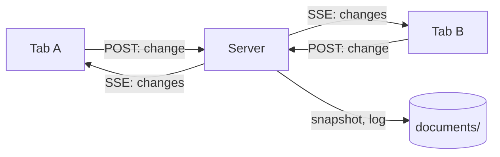
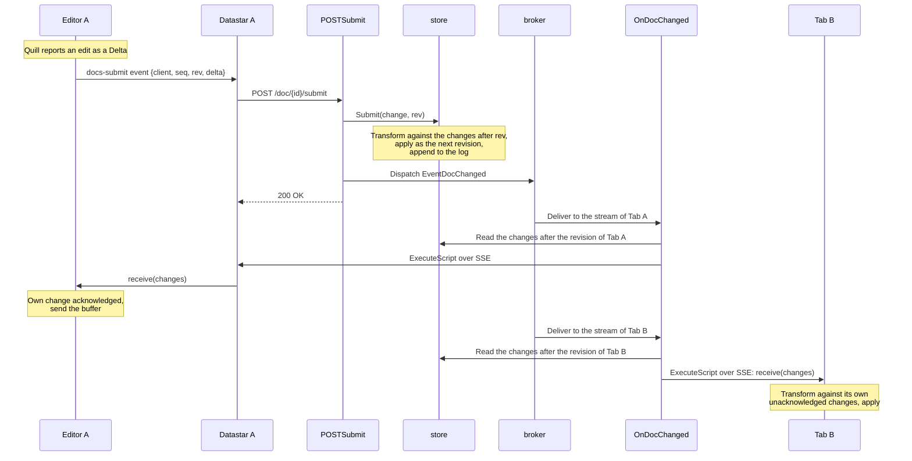
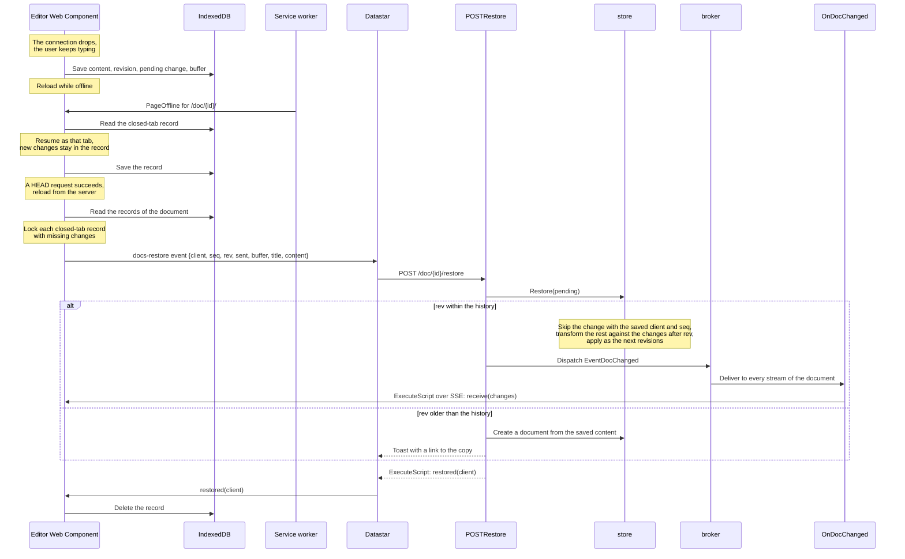

# Docs

A real-time collaborative rich text editor like [Google Docs](https://docs.google.com/). Any number of tabs can edit the same document and see each other's changes, cursors and avatars. A tab survives a reload and a temporary disconnection without losing changes.

The application is ~2,6k lines of Go, 457 lines of templ and ~1k lines of TypeScript, not counting blank lines, comments, tests and generated code.

The `documents` directory stores one snapshot and one change log for each document.

## How it works



All editor JavaScript runs in the `<docs-editor>` [Web Component](https://developer.mozilla.org/en-US/docs/Web/API/Web_components), which wraps [Quill](https://quilljs.com).

Quill reports each edit as a [Delta](https://quilljs.com/docs/delta/). The editor emits a `docs-submit` event. A Datastar `data-on:docs-submit` attribute turns the event into a `POST` request to `POSTSubmit`. The server puts changes from all tabs in one order. It sends each tab its missing changes over SSE with `ExecuteScript`. The script calls the editor's `receive` method. The editor merges the changes into its text, which may include changes that the server does not have yet. This design uses [OT (operational transformation)](https://en.wikipedia.org/wiki/Operational_transformation) with a central server.

The editor sends each change to `POSTSubmit` with the revision where it was made. The store transforms the change against all changes applied since that revision. It applies the result as the next revision and appends it to the document log. `POSTSubmit` then dispatches `EventDocChanged` with the document id. The broker delivers the event to the stream for every tab that has the document open. For each tab, `OnDocChanged` reads its missing changes from the store and passes them to the editor's `receive` method. The source tab also receives its change. This acknowledges the change.



The server sends the title, collaborators and cursors in the same way. `POSTRename` changes the title, and `POSTCursor` moves a cursor. `StreamOpen` adds the tab to the collaborators. `StreamClose` removes it. Each operation changes the store and dispatches `EventDocChanged`, which carries only the document id. `StateDoc` records the last state sent to a tab. `OnDocChanged` compares it with the store and sends the difference. It passes the changes and cursors to `receive`, then patches the avatars and the title as HTML. The `_title` signal gives the editor the title it stores in the browser.

`EventListChanged` reports a created, renamed, edited or deleted document. `OnListChanged` renders the document list again in every tab on `/`.

The code is in these directories:

| path | what |
| --- | --- |
| `app/` | pages, actions, events and templates |
| `app/datapagesgen/` | generated by `datapages gen` |
| `store/` | documents in memory and on disk, submitted change transformations, open tabs and cursor positions |
| `delta/` | the Delta operations of quill-delta, ported to Go |
| `richtext/` | allowed document formats, repairs for concurrent changes and document HTML |
| `images/` | uploaded images, one file per image named after the SHA-256 of its bytes |
| `templates/` | the documents a new document can start from, and their pictures |
| `web/src/` | the editor and styles that esbuild bundles into `app/static/` |
| `cmd/server/` | the entry point |

## Prerequisites

- [Go](https://go.dev/dl/) 1.27+
- [Node.js](https://nodejs.org/) 24+ for the editor bundle and its tests
- [Datapages](https://github.com/romshark/datapages) CLI (for `datapages watch`)

## Run

```sh
go run ./cmd/server -host 0.0.0.0:8080
```

Open http://localhost:8080/. To edit from another device, open `http://<this-machine>:8080/` on that device. Anyone who can reach the port can edit and delete documents. Without `-host`, the server listens only on `localhost:8080`. Use `-dir` to choose another document directory.

## Develop

```sh
make npm-install
make dev
```

Open http://localhost:7331/. Editing a file in `web/src/` rebuilds `editor.js`, `editor.css` and `style.css` in `app/static/`, then reloads the page.

## Test

```sh
make test
```

`go test ./...` tests the Delta port, document rules, store and HTTP protocol. `npm test` in `web/` runs three editors against a server model. It interleaves requests and streams at random, then checks that every editor ends with the server's document.

## Design notes

### The JavaScript

Edited text runs ahead of the server. Only the browser can merge changes from other users without losing keystrokes or moving the cursor. Datastar can replace an element or leave it unchanged, but it cannot merge changes into the element.

The page renders the document in Go with Quill's markup. The document appears before the bundle loads and stays in place when the editor replaces it.

### OT instead of a CRDT

A [CRDT](https://en.wikipedia.org/wiki/Conflict-free_replicated_data_type) such as [Yjs](https://yjs.dev) merges changes without a central order. It needs an id for every character and a tombstone for every deletion. This example uses a server to order changes, which keeps the document a plain Quill Delta that the server can check, repair and render as HTML.

A CRDT has these advantages:

- Several servers or browsers can accept and merge changes.
- A tab can rejoin after any number of changes.
- Editors can send changes without waiting for a reply.
- Duplicate or out-of-order changes do no harm.
- Cursors can stay anchored as the text changes.

### Deltas

A Delta is a flat list of formatted text runs. Each line break carries its line's formats. `delta/` ports the compose, transform and transformPosition operations from [quill-delta](https://github.com/slab/delta) 5.1.0 to Go. The Go tests compare the port with quill-delta results in `delta/testdata/quill-delta.json`. `web/vectors.mjs` writes that file. Positions count UTF-16 code units, as they do in JavaScript.

### The protocol

The editor sends one change at a time with the tab's client id and a sequence number. It buffers text that the user types while the change is pending. The editor sends the buffer when the change returns.

A dropped event loses no data. The broker drops events only for a stream with a backlog. The next delivered event includes everything covered by the dropped events. When a stream reconnects, `StreamOpen` reads the editor revision from the `rev` signal and sends the missing changes. The editor keeps this signal current. The page keeps its stream open while the tab is hidden because the default reload on return would discard the undo history.

A change can arrive twice. Datastar retries a request that failed to connect. The editor resends a change if it has not returned after 10 seconds. The store skips a change if it has already applied its client id and sequence number.

`GET` gives each page load a random client id. The tab uses it to send changes. The server never sends it to another tab, which sees a name and color derived from the id.

### Repairs

Two valid concurrent changes can produce a document that Quill cannot show. One tab may make a line a heading while another makes it a list item, which puts two line types on one line. Concurrent changes can also put text formats on a code line. Quill then shows the line differently in each editor because the editors applied the changes in different orders. `richtext.Repair` computes a change that removes the conflict, and the store applies it as the next revision. The repair keeps and reapplies the last line type, which makes every editor use it.

### Cursors

The editor reports its selection with `POSTCursor` only when the server has all its changes. Only then do its positions match the last revision. The store moves every cursor with every change. It moves a cursor past an insertion at that cursor from the same editor, but keeps it before an insertion from another editor. This matches how Quill moves the cursor in each editor. Before drawing received cursors, the editor moves them through its own unacknowledged changes.

### Storage

`store/` keeps each document in two files. `<id>.json` is a snapshot. `<id>.log` contains one JSON line per change. After 200 logged changes, the store writes a new snapshot and keeps the last 100 changes in the log. A process crash loses no applied changes because the next start replays the log.

The store keeps the last 1000 changes of a document in memory. It uses them to transform changes made at earlier revisions. After a restart, this history contains the logged changes: all changes since the last snapshot and the 100 changes before it. A tab that falls further behind cannot catch up. Its editor becomes read-only and offers a reload. After the reload, the changes the server lacked go to a new document, as described in [Disconnections](#disconnections).

### Disconnections

A reload, closed tab or lost connection preserves changes. They merge when the store still has the history after the tab's last revision, up to 1000 changes. Otherwise the saved content becomes a new document.

Each tab saves its editor state to IndexedDB at most every 500 ms while it changes. The record contains the content, last revision, pending change with its sequence number, and input buffer. `web/src/local.ts` manages these records. An open tab holds a [Web Lock](https://developer.mozilla.org/en-US/docs/Web/API/Web_Locks_API) named after its client id. An unlocked record belongs to a closed tab.

On load, the editor sends each closed-tab record with missing changes to `POSTRestore`. `store.Restore` processes the server changes after the saved revision. A matching client id and sequence number acknowledges the pending change. The store applies the remaining changes, and the streams deliver them as remote edits. The editor then deletes the record. If the store no longer has the saved revision, `POSTRestore` copies the saved content to a new document and links it in a toast.

After the first page load, the `modules/offline` service worker stores `PageOffline` and its files. `WithDatastarJS` serves Datastar from `app/static/` because the CDN is unavailable offline. While offline, the worker serves `PageOffline` for any address it has not cached. At a document address, the editor resumes a closed-tab record with missing changes or uses the newest stored content. New changes stay in the record. When a `HEAD` request succeeds, the page reloads and restores the record. At other addresses, the page lists stored documents.



IndexedDB records, Web Locks and the service worker require HTTPS or localhost. Over plain HTTP at `http://<this-machine>:8080/`, a reload loses changes missing from the server. Safari [deletes site storage](https://webkit.org/blog/10218/full-third-party-cookie-blocking-and-more/) after 7 days of Safari use without interaction with the site.

### One process

The example runs one server with the in-memory broker. Multiple servers would need a shared store and one place that orders each document's changes. For example, they could use a database row whose revision each change advances with compare-and-swap.
