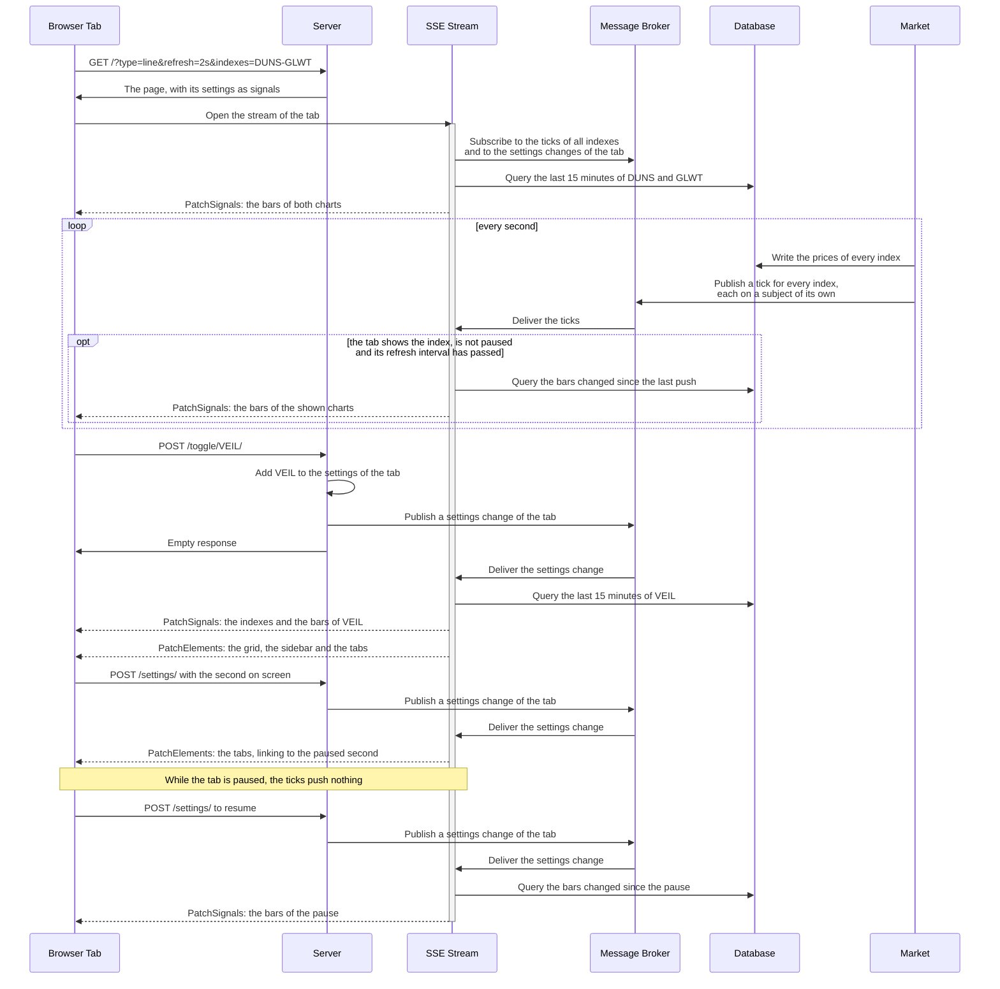

# Realtime Charts

A scrollable grid of charts of a simulated market, drawn by [TradingView Lightweight Charts](https://github.com/tradingview/lightweight-charts) and updated over one SSE stream per tab. The sidebar shows or hides the chart of each of 48 fictional indexes, or of all of them at once. The sticky navigation bar has a tab for the charts, one for a market map of all indexes, drawn by [Apache ECharts](https://echarts.apache.org/), and one for the indexes as a portfolio, drawn by [uPlot](https://github.com/leeoniya/uPlot). It also has a Live button that pauses the tab and a select for how often the tab receives updates (1s, 2s, 5s or 30s). A toolbar above the charts has a select for their chart type, one for their time range (the last 5 minutes to the last 24 hours), two buttons that lay them out in rows across the page or in a grid, and a button that syncs them. Every setting is a query parameter, and every view takes the same ones: `/?type=line&refresh=5s&range=1h&indexes=DUNS-GLWT&paused=1790506269&sync=true&layout=rows`.

| chart type | `type` | draws per bar |
| ---------- | ------ | ------------- |
| Candles | `candles` | a candlestick |
| Bars | `bars` | an OHLC bar |
| Line | `line` | a point of a line through the closing prices |
| Area | `area` | the same line, filled below |
| Baseline | `baseline` | the same line, filled above the opening price of the index in the up color and below it in the down color |
| Histogram | `histogram` | a column from the open to the close of the bar |

The market map at `/map/` shows every index as a tile of its sector, colored by its change since the open, and outlines the indexes of the sidebar.

The portfolio at `/portfolio/` holds equal parts of $100,000 in the indexes of the sidebar, bought at their opening prices. It shows its value, its return since the open next to the one of all 48 indexes, its sectors, the share and the profit or loss of every holding, its drawdown and how its returns from one 5-second bar to the next are distributed.

The Live button reads Paused while the tab is paused, and a second click resumes it. A paused tab stops drawing and disables the refresh select while the market keeps moving. Another time range redraws the charts over that range up to the paused second. The URL carries the second the charts are frozen at: a reload, a shared link and the tabs to the other views show the same moment. Resuming draws everything that changed during the pause. The database keeps one hour of prices by default, and a link to an older moment shows the oldest one it holds.

A click on a chart activates it until a click elsewhere or on the button after its name, and the border of its card shows it. Only an active chart zooms with the wheel: over the others the wheel scrolls the page. On a phone a tap activates a chart, and a swipe over any other chart scrolls the page.

The Sync button makes the charts follow the one under the pointer: its crosshair shows the same time on the others, and they scroll and zoom with it. The panels of the portfolio over time always share their cursor. The market map and the portfolio page have no toolbar.

A tab crossfades one view into the next, and the highlight of the current tab slides to the new tab. The views use cross-document view transitions in CSS. Browsers without them and users who prefer reduced motion switch views at once.

## Prerequisites

- [Go](https://go.dev/dl/) 1.27+
- [Datapages](https://github.com/romshark/datapages) CLI (for `datapages watch`)

The chart pages load Lightweight Charts 5.2.1, the market map Apache ECharts 6.1.0 and the portfolio page uPlot 1.6.32 from jsDelivr. Subresource integrity hashes pin the files. The pages load Datastar 1.0.4 with Rocket, its web component API, from `app/static/datastar-rocket.js`, which the chart elements import as well.

## Run

```sh
go run ./cmd/server
```

Then open http://localhost:8080/. `HOST` and `PORT` choose another address. `HISTORY` sets how far back the database keeps prices, such as `HISTORY=24h`. Every hour takes about 11 MB. The time range select offers the ranges the history spans: up to the last hour by default, all of them with `HISTORY=24h`.

## Develop

```sh
datapages watch
```

Then open http://localhost:7331/.

## Architecture

The example follows the [CQRS](https://data-star.dev/guide/the_tao_of_datastar#cqrs) architecture of Datastar: every tab reads over one long-lived SSE stream, commands are short-lived actions and the server holds all state.

- **Database.** An in-memory time-series database holds the prices of every index for the last hour, or the `HISTORY`, and is the source of truth. It answers any time range, as points or as bars.
- **Market.** A simulator runs next to the server. On start it fills the database with the whole history. Then, every second, it writes the new prices and announces every index on a message broker subject of its own. An announcement carries only the index, and the streams read the prices from the database.
- **Streams.** The stream of a tab listens to the subjects of all indexes. When an index the tab shows ticks and the refresh interval of the tab has passed, the stream pushes the bars of the charts the tab shows. A paused tab gets no pushes while the market keeps moving.
- **Charts as queries.** A chart is a query of the database, over any time range up to any moment. A new page shows its time range, the last 15 minutes by default, and a paused page the range up to its pause. The bars of a range are the shortest of 5s, 10s, 15s, 30s, 1m, 2m, 5m, 10m and 15m that keep it within 120 bars: 10 seconds for 15 minutes, 15 minutes for 24 hours. A push carries the bars that changed since the previous push. The page sends the time of its last push back with every request, which lets a stream that reconnects continue where it left off. A hidden tab that is shown again reconnects its stream instead of reloading, which would drop the bars its charts have drawn.
- **Market map.** The map shows every index, whichever the sidebar selects, and outlines the selected ones in the browser. A push carries the price and the change of every index.
- **Portfolio.** The portfolio page is one more view of the same indexes, and its panels are queries of the same database. A push carries the bars of the value and the allocation that changed, and the whole drawdown and distribution, which depend on the whole window. The ring of the sectors is SVG that the server renders and patches as HTML, since it changes only with the indexes.
- **Actions.** Showing or hiding one index or all of them, changing the chart type, the time range, the layout or the refresh interval, pausing and syncing the charts are actions, and the server keeps their settings per tab. An action answers with nothing. It changes the settings and notifies the stream of the tab through the broker, and the stream renders the change: the bars of an added chart, the grid, the sidebar and the tabs. A resume pushes everything that changed during the pause without waiting for the next tick.
- **URLs.** Every view is a page of its own, and the tabs are links. The page keeps the settings in the URL: a reload, a shared link and the other views show the same charts, and a paused link the same moment.
- **One process.** An in-memory broker suffices because the database and every stream that reads it live in one process. Two processes would simulate two different markets.


### Signal patches instead of a fat morph

Unlike most other examples, this page does not update its charts with fat morphs. A chart draws on a canvas, not from HTML, and a push carries data instead of markup: a `PatchSignals` event with the bars that changed since the previous push, one or two per chart at 1s, and the price and change of every chart. The server patches the grid as HTML only when the selection, the chart type or the time range changes, and the sidebar only when the selection changes. Measured in Chrome with 8 candlestick charts at 1s, the stream delivers 960 bytes per second, 140 after Brotli. The market map gets 1.1 KB per push, 260 bytes after Brotli. A portfolio of 6 indexes at 1s gets 11 KB first, 3.2 KB after Brotli, and then 2.9 KB per second, 100 bytes after Brotli: most of a push repeats the drawdown of the previous one.

The bars live in a signal whose name starts with an underscore, which Datastar never sends back to the server with an action or a reconnecting stream.

### The charts

The charts are custom elements defined with [Rocket](https://data-star.dev/reference/rocket), one each around Lightweight Charts, Apache ECharts and uPlot, the only JavaScript in the example. They decide nothing about what they show. With sync on, the charts of a page pass their crosshair and their visible range between them in the browser, and the server keeps only the setting. A chart merges the bars it receives into the ones it has drawn. Merging the same bars twice changes nothing, which lets a chart receive its bars again at any time. A chart draws into a shadow root, which a morph of the page leaves alone.

### Interaction flow

Solid arrows are requests, responses and broker messages. Dashed arrows are events on the SSE stream of the tab.



## Attribution

[TradingView Lightweight Charts&trade;](https://github.com/tradingview/lightweight-charts) is Copyright (c) 2025 TradingView, Inc. and licensed under the [Apache License 2.0](https://github.com/tradingview/lightweight-charts/blob/master/LICENSE).

[Apache ECharts](https://echarts.apache.org/) is Copyright 2017-2026 The Apache Software Foundation and licensed under the [Apache License 2.0](https://github.com/apache/echarts/blob/master/LICENSE).

[uPlot](https://github.com/leeoniya/uPlot) is Copyright (c) 2022 Leon Sorokin and licensed under the [MIT License](https://github.com/leeoniya/uPlot/blob/master/LICENSE).
