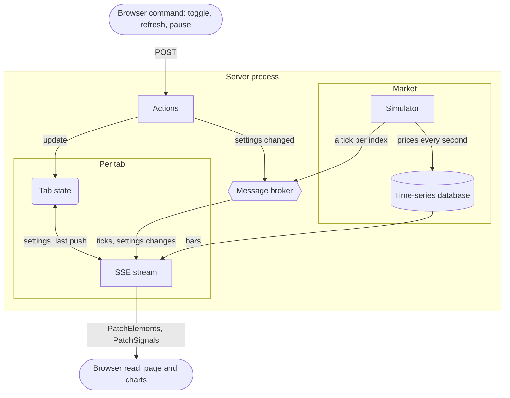
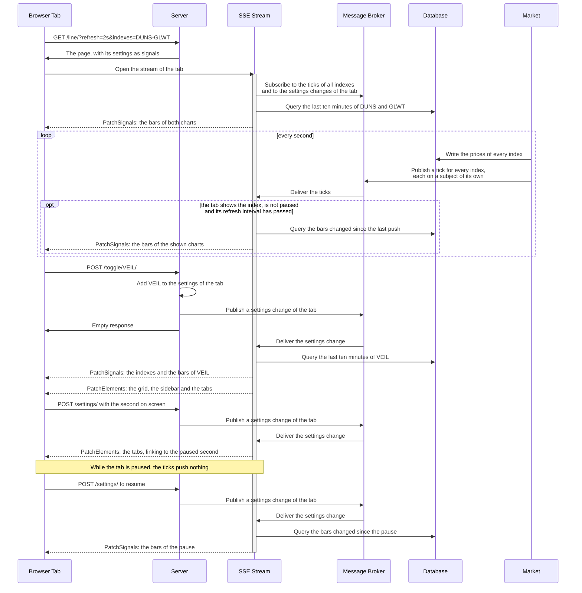

# Realtime Charts

A scrollable grid of charts of a simulated market, drawn by [TradingView Lightweight Charts](https://www.tradingview.com/lightweight-charts/) and updated over one SSE stream per tab. The sidebar shows or hides the chart of each of 48 fictional indexes. The sticky navigation bar has a tab for every chart type, a Live button that pauses the tab and a select for how often the tab receives updates: 1s, 2s, 5s or 30s. Every setting is a query parameter, and every view takes the same ones: `/line/?refresh=5s&indexes=DUNS-GLWT&paused=1790506269`.

| tab | route | draws per 5-second bar |
| --- | ----- | ---------------------- |
| Candles | `/` | a candlestick |
| Bars | `/bars/` | an OHLC bar |
| Line | `/line/` | a point of a line through the closing prices |
| Area | `/area/` | the same line, filled below |
| Baseline | `/baseline/` | the same line, filled above the opening price of the index in the up color and below it in the down color |
| Histogram | `/histogram/` | a column from the open to the close of the bar |

The Live button reads Paused while the tab is paused, and a second click resumes it. A paused tab stops drawing and disables the refresh select while the market keeps moving. The URL carries the second the charts are frozen at: a reload, a shared link and the tabs to the other views show the same moment. Resuming draws everything that changed during the pause. The database keeps one hour of prices, and a link to an older moment shows the oldest one it holds.

## Prerequisites

- [Go](https://go.dev/dl/) 1.27+
- [Datapages](https://github.com/romshark/datapages) CLI (for `datapages watch`)

The page loads Lightweight Charts 5.2.1 from jsDelivr. A subresource integrity hash pins the file.

## Run

```sh
go run ./cmd/server
```

Then open http://localhost:8080/. `HOST` and `PORT` choose another address.

## Develop

```sh
datapages watch
```

Then open http://localhost:7331/.

## Architecture

The example follows the [CQRS](https://data-star.dev/guide/the_tao_of_datastar#cqrs) architecture of Datastar: every tab reads over one long-lived SSE stream, commands are short-lived actions and the server holds all state. This section describes the parts and how they work together. The code and its comments cover the details.

- **Database.** An in-memory time-series database holds the prices of every index for the last hour and is the source of truth. It answers any time range, as points or as bars.
- **Market.** A simulator runs next to the server. On start it fills the database with an hour of prices. Then, every second, it writes the new prices and announces every index on a message broker subject of its own. An announcement carries only the index, and the streams read the prices from the database.
- **Streams.** The stream of a tab listens to the subjects of all indexes. When an index the tab shows ticks and the refresh interval of the tab has passed, the stream pushes the bars of the charts the tab shows. A paused tab gets no pushes while the market keeps moving.
- **Charts as queries.** A chart is a query of the database, which makes any moment and any range a chart. A new page shows the last ten minutes, a paused page the ten minutes up to its pause, and a push carries the bars that changed since the previous push. The page sends the time of its last push back with every request, so a stream that reconnects continues where it left off. A hidden tab that is shown again reconnects its stream instead of reloading, which would drop the bars its charts have drawn.
- **Actions.** Showing or hiding an index, changing the refresh interval and pausing are actions, and the server keeps their settings per tab. An action answers with nothing. It changes the settings and notifies the stream of the tab through the broker, and the stream renders the change: the bars of an added chart, the grid, the sidebar and the tabs. A resume pushes everything that changed during the pause without waiting for the next tick.
- **URLs.** Every view is a page of its own, and the tabs are links. The page keeps the settings in the URL, so a reload, a shared link and the other views show the same charts, and a paused link the same moment.
- **One process.** An in-memory broker suffices because the database and every stream that reads it live in one process. Two processes would simulate two different markets.



### Signal patches instead of a fat morph

Unlike most other example applications, this page doesn't use fat morphs, instead `PatchSignals` is used to update... [TODO]

A chart is drawn on a canvas, not from HTML, so a push carries data, not markup: a signal patch with the bars that changed since the previous push, one or two per chart at 1s, and the price and change of every chart. The server patches the grid and the sidebar as HTML only when the selection changes. Measured in Chrome with 8 candlestick charts at 1s, the stream delivers 960 bytes per second, 140 after Brotli.

The bars live in a signal whose name starts with an underscore, so Datastar never sends them back to the server with an action or a reconnecting stream.

### The charts

The charts are custom elements around Lightweight Charts, the only JavaScript in the example. They decide nothing about what they show. A chart merges the bars it receives into the ones it has drawn, and merging the same bars twice changes nothing, so a chart can receive its bars again at any time. A chart draws into a shadow root, which a morph of the grid leaves alone.

### Interaction flow

Solid arrows are requests, responses and broker messages. Dashed arrows are events on the SSE stream of the tab.



## Attribution

TradingView Lightweight Charts&trade; is Copyright (c) 2025 TradingView, Inc. and licensed under the [Apache License 2.0](https://github.com/tradingview/lightweight-charts/blob/master/LICENSE). The library asks for the text of its NOTICE file in the code, which the script of the chart element carries, and a link to https://www.tradingview.com/ on the page, which the footer carries. The logo it would draw on every chart is turned off.
