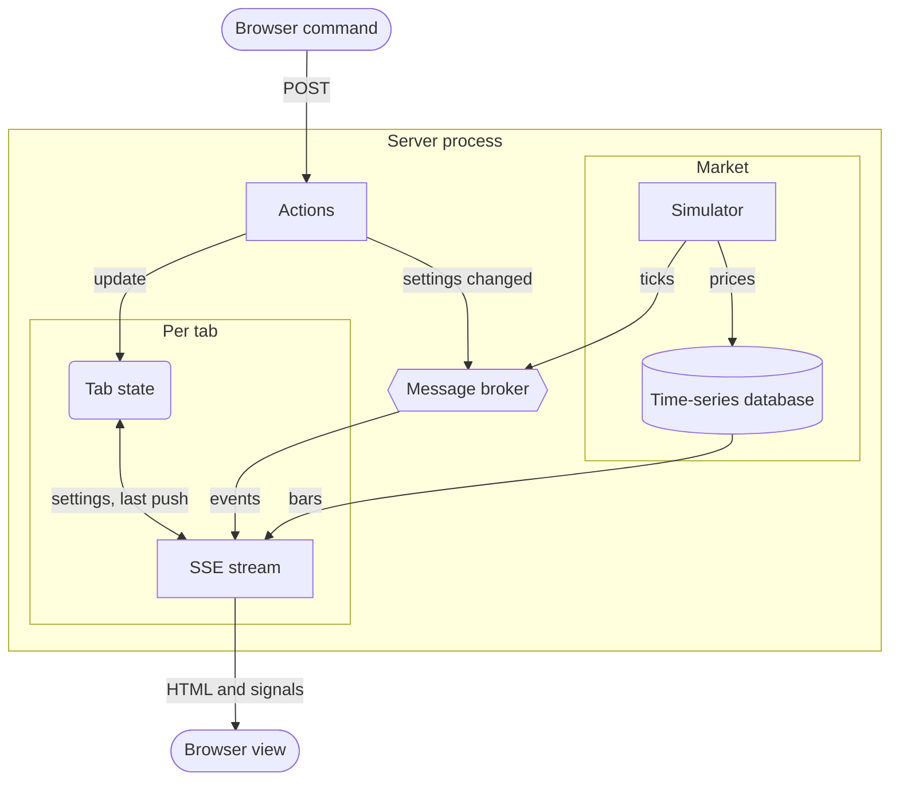

# Realtime Charts

This example simulates 48 market indexes and serves 3 views, each updated over 1 SSE stream per tab.

- `/` shows selected indexes with [Lightweight Charts](https://github.com/tradingview/lightweight-charts).
- `/map/` shows every index by sector with [Apache ECharts](https://echarts.apache.org/).
- `/portfolio/` treats selected indexes as equal parts of a $100,000 portfolio and uses [uPlot](https://github.com/leeoniya/uPlot).

The shared controls select indexes, update intervals, time ranges and a paused second. The chart page also selects the chart type and layout and can sync its charts. Query parameters preserve every setting across reloads, shared links and views.

| chart type | `type` | draws per bar |
| ---------- | ------ | ------------- |
| Candles | `candles` | candlestick |
| Bars | `bars` | OHLC bar |
| Line | `line` | closing-price line |
| Area | `area` | filled closing-price line |
| Baseline | `baseline` | line filled relative to the opening price |
| Histogram | `histogram` | column from open to close |

Pausing freezes a tab while the market continues. Changing the range redraws data up to the paused second. Resuming sends everything that changed during the pause.

## Prerequisites

- [Go](https://go.dev/dl/) 1.27+
- [Datapages](https://github.com/romshark/datapages) CLI for `datapages watch`

The pages load Lightweight Charts 5.2.1, Apache ECharts 6.1.0 and uPlot 1.6.32 from jsDelivr with subresource integrity. `app/static/datastar-rocket.js` provides Datastar 1.0.4 and Rocket.

## Run

```sh
go run ./cmd/server
```

Open <http://localhost:8080/>. `HOST` and `PORT` change the address. `HISTORY` sets retention, such as `HISTORY=24h`. The default `1h` uses about 11 MB.

## Develop

```sh
datapages watch
```

Open <http://localhost:7331/>.

## Architecture

The example follows Datastar's [CQRS](https://data-star.dev/guide/the_tao_of_datastar#cqrs) model. Tabs read over SSE, actions send commands and the server owns all state.

- **Database.** An in-memory time-series database stores prices for `HISTORY` and returns points or OHLC bars.
- **Market.** A simulator fills the history, writes prices every second and publishes 1 event per index. Events carry only the index because streams read prices from the database.
- **Streams.** Each tab subscribes to every index but pushes only when a shown index changes and its update interval has passed. A reconnect renders the full view and restores missed state.
- **Queries.** Each chart reads a time range ending at the live or paused second. Bar lengths keep the result within 120 bars.
- **Actions.** Actions update per-tab settings, then publish a settings event. The tab's stream renders the view, sidebar and links.
- **URLs.** Reflected query fields keep settings in links. Each view has its own page.
- **Process.** The database, simulator and streams share 1 process. A second process would simulate a different market.



### Fat morphs

Each push sends the complete chart grid, market map or portfolio plus the displayed second. Chart data is JSON in element attributes. The browser receives no application script from the server.

Most bytes repeat the previous push. Stream compression reduces later pushes to little more than the changes. At a 1-second update interval, Chrome produced these sizes with the default zstd configuration.

| view | first push | later push |
| ---- | ---------- | ---------- |
| 8 candlestick charts | 34 KB, 9.8 KB compressed | 35 KB, 220 bytes compressed |
| market map | 4.4 KB, 1.8 KB compressed | 4.6 KB, 360 bytes compressed |
| portfolio of 6 indexes | 17 KB, 4.4 KB compressed | 18 KB, 180 bytes compressed |

The initial `GET` includes the same full view.

### Chart elements

[Rocket](https://data-star.dev/reference/rocket) defines `<rt-chart>`, `<market-map>` and `<pf-chart>`. Each element redraws when a morph changes its JSON attributes. The server decides what it shows.

`<rt-chart>` merges new bars with existing ones to preserve zoom and older bars. With sync enabled, charts share their crosshair and visible range. The map and portfolio charts replace their data. Each library draws in a shadow root that page morphs leave intact.

## Attribution

[TradingView Lightweight Charts&trade;](https://github.com/tradingview/lightweight-charts) is Copyright (c) 2025 TradingView, Inc. and licensed under the [Apache License 2.0](https://github.com/tradingview/lightweight-charts/blob/master/LICENSE).

[Apache ECharts](https://echarts.apache.org/) is Copyright 2017-2026 The Apache Software Foundation and licensed under the [Apache License 2.0](https://github.com/apache/echarts/blob/master/LICENSE).

[uPlot](https://github.com/leeoniya/uPlot) is Copyright (c) 2022 Leon Sorokin and licensed under the [MIT License](https://github.com/leeoniya/uPlot/blob/master/LICENSE).
