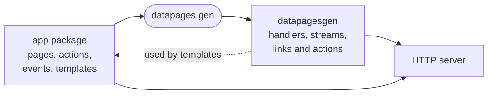

# Introduction

Datapages generates a Go HTTP server from pages, actions and events declared in an application package. [Templ](https://templ.guide) components render HTML. [Datastar](https://data-star.dev) sends browser input to actions and morphs server-rendered patches into the DOM over [server-sent events](https://developer.mozilla.org/en-US/docs/Web/API/Server-sent_events/Using_server-sent_events).

The server owns the data, state and application rules. The browser presents the HTML, keeps local interaction state and sends user actions. Generated URL and action helpers make missing routes fail at compile time, and the CLI rejects unsupported handlers and hardcoded application URLs. `datapages watch` regenerates, rebuilds and reloads the application after a change.

This [counter example](../example/counter/app/simple/) updates every open tab:

```go title="app/simple/app.go"
package simple

import (
	"net/http"
	"sync/atomic"

	"github.com/romshark/datapages"
)

// EventCounterUpdated is "simple.counter.updated"
type EventCounterUpdated struct{}

type App struct{ counter atomic.Int32 }

func (*App) Head(_ *http.Request) datapages.Head { return head() }

// PageIndex is /
type PageIndex struct{ App *App }

func (p PageIndex) GET(r *http.Request) (body datapages.Component, err error) {
	return pageCounter(p.App.counter.Load()), nil
}

// POSTAdd is /add/{$}
func (p PageIndex) POSTAdd(
	r *http.Request, counterUpdated datapages.Dispatcher[EventCounterUpdated],
	query datapages.Query[struct {
		Delta int32 `query:"delta"`
	}],
) error {
	p.App.counter.Add(query.Values.Delta)
	return counterUpdated.Dispatch(EventCounterUpdated{})
}

func (p PageIndex) OnCounterUpdated(
	event EventCounterUpdated, sse datapages.SSE,
) error {
	return sse.PatchElement(pageCounter(p.App.counter.Load()))
}
```

```templ title="app/simple/app.templ"
templ pageCounter(value int32) {
	<div id="page-counter">
		<button data-on:click={ action.PageIndex.Add.POST(action.PageIndex.Add.POSTQuery(-1)) }>-</button>
		<span id="value">{ fmt.Sprint(value) }</span>
		<button data-on:click={ action.PageIndex.Add.POST(action.PageIndex.Add.POSTQuery(1)) }>+</button>
	</div>
}
```

- `PageIndex` is a page. The first line of its doc comment declares its route, `/`. `GET` renders the page with the templ component `pageCounter`. `App.Head` returns the `<head>` tags that every page gets.
- `POSTAdd` is an action. The `-` and `+` buttons of `pageCounter` call it through Datastar with a `delta` query parameter, as `@post('/add/?delta=1')`. It adds `delta` to the counter and dispatches `EventCounterUpdated`.
- `OnCounterUpdated` handles the event in every tab that has the page open. It renders the counter again and sends it over the SSE stream of the tab. Datastar morphs it into the element with the same ID.

`datapages gen` writes route handlers, page streams and typed template helpers below the app package in `datapagesgen`. The `href` package builds links, and the `action` package builds Datastar actions.



The in-memory message broker delivers events within 1 server process. Use NATS across processes.

## When to use Datapages

Datapages fits an application whose server owns its data and rules. Use it when:

- the application is written mostly in Go and Templ;
- the browser sends commands instead of changing authoritative data itself;
- changes must reach other open tabs or server processes;
- the browser does not need a separate REST or GraphQL API; or
- the same app package runs as a web server and a desktop app, as in [`example/calculator`](../example/calculator/).

## When not to use Datapages

Use a client-side application when it must run independently of a server or deploy as static files to a CDN. For a static site, use Templ directly. This [documentation site](../internal/tools/render-pages/) does that. Datastar and Web Components can add client-side interaction without Datapages.

## How these docs are organized

- Start with [Installation](installation.md), then build the application in the [tutorial](tutorial/README.md).
- [Application model](application-model.md) explains the source and generated code. [Request lifecycle](request-lifecycle.md) follows a page load, stream, action and event through the server.
- Use the task guides for implementation and the [specification](../SPECIFICATION.md), [CLI](cli.md), [configuration](configuration.md) and [Go API](https://pkg.go.dev/github.com/romshark/datapages) for reference.

## Get help

- Ask questions in the #datapages channel on [Discord](https://discord.com/channels/1296224603642925098/1464634812135505940) or on the [Gophers Slack](https://gophers.slack.com/archives/C0AKMFC1M2A).
- Report bugs and propose features in [GitHub issues](https://github.com/romshark/datapages/issues). Include the output of `datapages version --full` and `go version` in a bug report.
- Report vulnerabilities privately as [SECURITY.md](../SECURITY.md) describes. Do not use a public issue.
