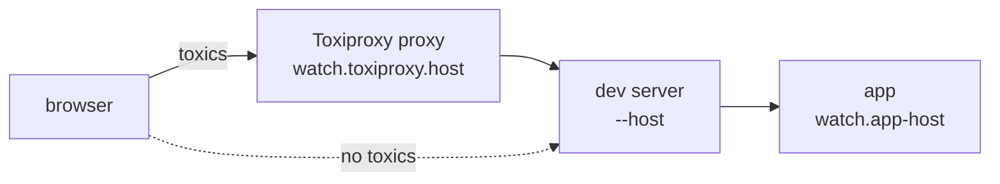

# Slow and failing networks

`datapages watch` can serve the app through a [Toxiproxy](https://github.com/Shopify/toxiproxy) proxy. Its toxics add latency, limit bandwidth, cut connections and return HTTP errors. A settings page applies presets, changes them while the app runs and saves them to `datapages.yaml`. Use the proxy to test pages, actions and streams on slow or failing networks.

## Open the app through the proxy

`datapages watch` prints the address of the proxy and of its settings page when it starts. The OS picks their ports unless [`host`](configuration.md#host) and [`ui-host`](configuration.md#ui-host) set them:

```text
toxiproxy: http://localhost:52417 (settings: http://localhost:52419/)
```

Open the first address to use the app with toxics. The `--host` address of the dev server, `http://localhost:7331` by default, keeps serving it without toxics. Pages opened through either address reload after a rebuild and show build errors.



Set the ports in `datapages.yaml` to keep the addresses across restarts:

```yaml title="datapages.yaml"
watch:
  toxiproxy:
    host: localhost:7332
    ui-host: localhost:7333
```

The ports must differ from those of `--host` and [`app-host`](configuration.md#app-host).

## Apply a preset

Choose a preset in the header of the settings page. The list starts with No throttling, ends with Unreachable and shows the presets from `datapages.yaml` between them. Each `datapages watch` run starts with No throttling. It does not save the selected preset.

| Preset | Toxics |
| ------ | ------ |
| No throttling | Built in. None |
| Fast 4G | In the scaffold `datapages.yaml`. `latency` 165ms downstream, `client-bandwidth` 8.1 Mbit/s downstream and 1.35 Mbit/s upstream |
| Slow 4G | In the scaffold `datapages.yaml`. `latency` 563ms downstream, `client-bandwidth` 1.44 Mbit/s downstream and 675 kbit/s upstream |
| 3G | In the scaffold `datapages.yaml`. `latency` 2000ms downstream, `client-bandwidth` 400 kbit/s downstream and upstream |
| Unreachable | Built in. `reset-peer` with a `timeout` of 0s downstream and upstream. A request ends before the app gets it, and an open stream ends at its next event |

`datapages init` writes Fast 4G, Slow 4G and 3G into a new `datapages.yaml`, and `datapages watch` writes the same file into a module without one. They have the values of the network presets of Chrome DevTools, with the latency rounded to whole milliseconds. Chrome shares the bandwidth per tab, the proxy per browser.

Under Slow 4G and 3G, every action takes long enough to see what the page shows between the click and the result. A control that shows no change in that time needs a [loading indicator](templates.md#show-that-an-action-runs).

Unreachable is not the Offline mode of Chrome. The browser stays online, with `navigator.onLine` true and no `offline` event, while no request reaches the server, as when the server is down or a network passes no traffic. An app that relies on `navigator.onLine`, such as through the `is-offline` class of the [offline module](offline.md), sees no change. Test the browser offline with the network throttling of its developer tools.

## Change the toxics

The settings page changes toxics globally or for 1 endpoint. A change applies to new requests and open connections, including page streams.

Changes update the selected configured preset in memory. Changes to No throttling or Unreachable appear as Unsaved. Save to config asks for a name, and changing presets asks before discarding unsaved changes. New preset copies the current settings. Configured presets can be deleted; No throttling replaces a deleted selection.

Save to config rewrites `watch.toxiproxy` in `datapages.yaml` and removes comments inside that section. It preserves the rest of the file and writes `host` and `ui-host` only when already set. Reload config reads the presets from disk. Host changes apply after `datapages watch` restarts. Saving or editing the file does not restart the app.

## Write a preset

A preset in [`watch.toxiproxy.presets`](configuration.md#presets) has a `name`, the `toxics` of every endpoint and the `endpoints` that override them:

```yaml title="datapages.yaml"
watch:
  toxiproxy:
    presets:
      - name: Flaky
        toxics:
          latency:
            downstream:
              latency: 300ms
              jitter: 100ms
          client-bandwidth:
            downstream:
              rate: 256000
        endpoints:
          "POST /upload/{$}":
            client-bandwidth:
              upstream:
                rate: 16000
            latency:
              downstream:
                disabled: true
          "POST /post/{slug}/like/{$}":
            http-error:
              downstream:
                status: 500
                toxicity: 0.5
```

The name is what the settings page lists. No throttling and Unreachable are reserved. Each toxic type takes a `downstream` toxic for the data the server sends and an `upstream` toxic for the data the browser sends. Flaky delays every response by 200ms to 400ms and limits each browser to 256 kB/s downstream. Uploads to `/upload/` arrive at 16 kB/s without the latency, and 1/2 of the likes answer 500.

## Toxics

| Type | Fields | Effect |
| ---- | ------ | ------ |
| `latency` | `latency`, `jitter`: whole milliseconds, up to 24h | Delays the data by `latency`, plus or minus up to `jitter` |
| `client-bandwidth` | `rate`: bytes per second, from 1 to 10000000000. `per`: `client` or `request`, default `client` | Limits the rate of each browser. Per client, the requests of 1 browser share it |
| `server-bandwidth` | `rate`: bytes per second, from 1 to 10000000000 | Limits the rate of all browsers together |
| `data-cap` | `volume`: bytes. `rate`: bytes per second, from 1 to 10000000000. `per`: `client` or `request`, default `client` | Limits the rate to `rate` once `volume` bytes have passed. Per client, the requests of 1 browser use up 1 volume |
| `slow-close` | `delay`: whole milliseconds, up to 24h | Delays closing the connection |
| `timeout` | `timeout`: whole milliseconds, up to 24h | Stops all data and closes the connection after `timeout`. `0s` holds the connection until the browser gives up |
| `reset-peer` | `timeout`: whole milliseconds, up to 24h | Resets the connection with a TCP RST once data arrives, after `timeout` |
| `slicer` | `average-size`, `size-variation`: bytes. `delay`: whole microseconds, up to 24h | Splits the data into chunks of `average-size` bytes, plus or minus up to `size-variation`, and delays each by `delay` |
| `limit-data` | `bytes`: bytes | Closes the connection after `bytes` bytes |
| `http-error` | `status`: 400 to 599 | Answers with `status`. Upstream, the app never gets the request. Downstream, the browser gets `status` in place of the response of the app |

Every toxic also takes these fields:

- `toxicity`: the share of requests the toxic applies to, from 0 to 1. Default 1. The settings page shows it in percent as "Requests affected".
- `disabled`: `true` turns the toxic off, and its other fields may be left out. On an endpoint, it turns off the global toxic of the same type and stream.

A value outside its range fails every command that loads `datapages.yaml`, as `toxicity 1.5 must be from 0 to 1`.

### HTTP errors

The proxy applies `http-error` itself, not Toxiproxy. It answers with the status and its standard text, as the generated server answers an error that no `PageError500`, `PageError404` or `RecoverError` handles. The toxic stands for a failure in front of the app, such as a gateway or a crashed process. To test the error handling of the app, return an error from the handler.

Upstream, the proxy answers at once and skips the other toxics. Downstream, the request passes the other toxics, and the app finishes its response before the proxy replaces it. A page stream gets the status when its head arrives, which ends the stream. With both set, a request that the upstream toxic answers never reaches the downstream one.

### Bandwidth and data caps

The proxy also applies `client-bandwidth`, `server-bandwidth` and `data-cap` itself.

With `per: client`, requests from 1 browser share the `client-bandwidth` rate and the `data-cap` volume. The proxy identifies a browser with the `datapages_toxiproxy` cookie and removes the cookie before forwarding a request to the app. Browser tabs share it; a private window gets another. A client without cookies, such as curl, gets a rate and volume per request. Cookies ignore ports, which sends this cookie to `--host` too.

With `per: request`, each request gets the full rate and volume. All requests share `server-bandwidth`. An endpoint override gets a separate rate or volume. Changing or resetting `data-cap`, or restarting `datapages watch`, restores its full volume. When several bandwidth toxics apply, the slowest controls the transfer.

## Target 1 endpoint

An endpoint key is the [`net/http.ServeMux`](https://pkg.go.dev/net/http#ServeMux) pattern that the generated server registers, method included:

| Endpoint | Pattern |
| -------- | ------- |
| Index page | `GET /` |
| Page `/post/{slug}/` | `GET /post/{slug}/{$}` |
| Its stream | `GET /post/{slug}/_$/{$}` |
| Its action `POSTLike` | `POST /post/{slug}/like/{$}` |
| Assets under `/static/` | `GET /static/` |

The toxics of an endpoint replace the global toxic of the same type and stream. The other global toxics still apply. The settings page lists the patterns of the app. The proxy matches a request to an endpoint as the generated server does, and reads the endpoints again after every `datapages gen`. A request that matches no endpoint gets the global toxics.

[`datapages lint`](cli.md#datapages-lint) reports an endpoint key that names no route of any app package of the module, and `datapages watch` warns about it when it starts:

```text
error: watch.toxiproxy.presets["Edge"].endpoints: no endpoint has the pattern "GET /not-found/"; did you mean "GET /not-found/{$}"?
```

## How requests pass the proxy

- Each request reaches the dev server on a connection of its own, which applies `toxicity` and the toxics that end a connection per request.
- A toxic that ends the connection to the dev server ends the connection to the browser without a response.
- The proxy keeps the `Host` header of the browser, which the cross-origin check of the generated server compares the `Origin` header with.
- `/__templier/events`, the connection that reloads the page after a rebuild, bypasses the toxics.
- With [`watch.tls`](configuration.md#watchtls), the proxy and the settings page serve HTTPS with the same certificate.

## Turn the proxy off

`watch.toxiproxy.disabled: true` turns the proxy and the settings page off, and `datapages lint` then skips the endpoint keys:

```yaml title="datapages.yaml"
watch:
  toxiproxy:
    disabled: true
```

The proxy connects to `--host`. A `--host` with port 0 turns it off, with a warning when `datapages.yaml` has a `watch.toxiproxy` section.

When the proxy cannot start, as on a port in use, `datapages watch` fails if `datapages.yaml` has a `watch.toxiproxy` section. Without the section, it prints a warning that starts with `warning: toxiproxy is off:` and runs without the proxy. The scaffold `datapages.yaml` has the section. See [Troubleshooting](troubleshooting.md#the-toxiproxy-port-is-in-use).

## See also

- [`watch.toxiproxy`](configuration.md#watchtoxiproxy): the keys and their defaults.
- [`datapages watch`](cli.md#datapages-watch): what the dev server does on startup and on a file change.
- [Offline and shims](offline.md#test-it-locally): test the app with the browser offline.
- [`example/classifieds`](../example/classifieds/): a preset that delays sent messages and resets the stream of the messages page.
- [Toxiproxy toxics](https://github.com/Shopify/toxiproxy#toxics): the toxics that Toxiproxy applies.
